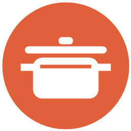
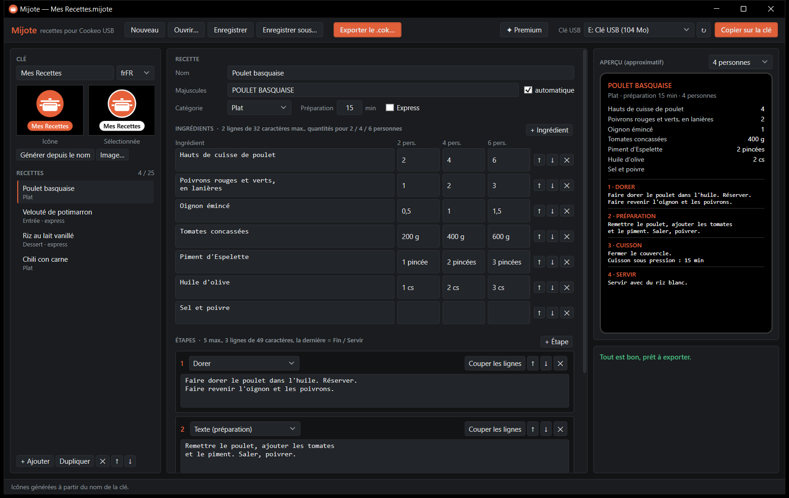
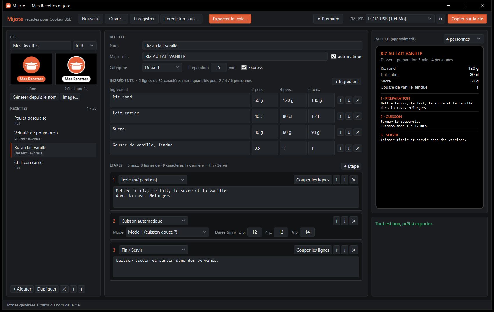
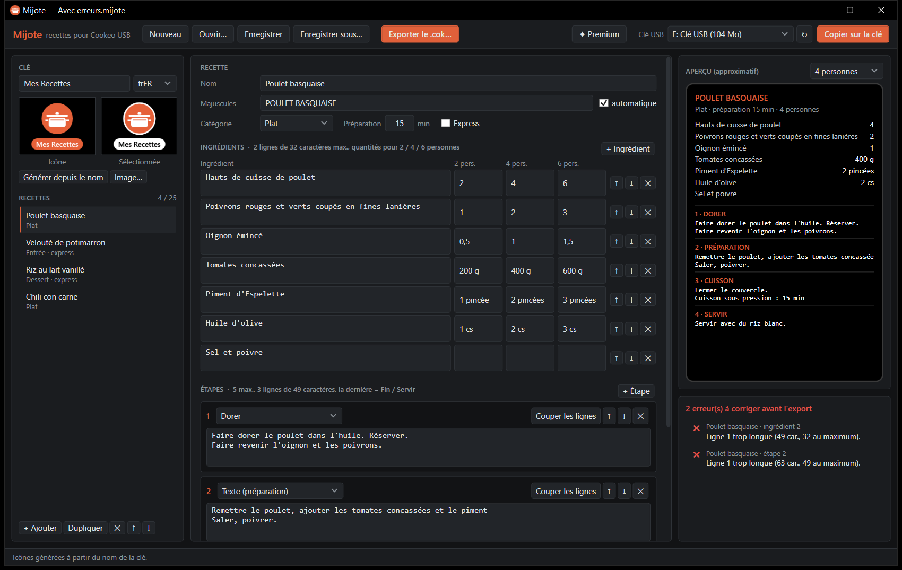
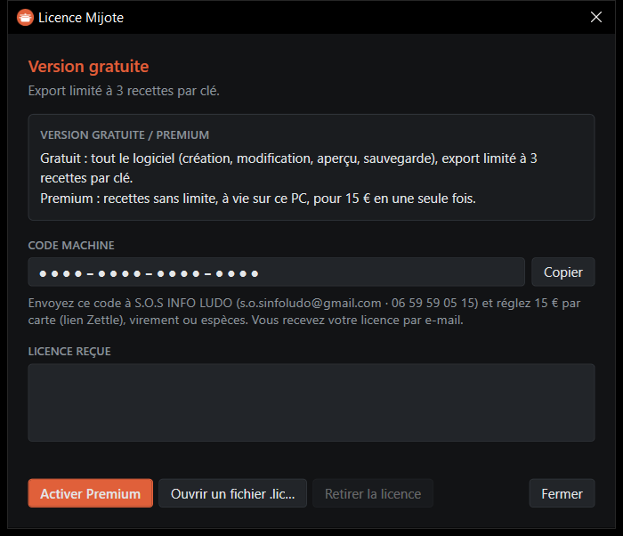

# Mijote

### Vos propres recettes sur votre Cookeo USB.

*Écrivez vos recettes sur le PC, Mijote crée le fichier que le Cookeo sait lire : ingrédients pour 2, 4 et 6 personnes, étapes guidées et cuisson automatique, comme les recettes d'origine.*

 

 

<i>Une recette en cours d'écriture : ingrédients et quantités à gauche, aperçu de l'écran du Cookeo à droite.</i>

  

[**Pourquoi**](#-pourquoi-mijote-) · [**Fonctionnalités**](#-fonctionnalités) · [**Gratuit ou Premium**](#-gratuit-ou-premium-) · [**En images**](#%EF%B8%8F-en-images) · [**Télécharger**](#%EF%B8%8F-télécharger) · [**Questions fréquentes**](#-questions-fréquentes)

 

---

## 💡 Pourquoi Mijote ?

Le Cookeo USB guide pas à pas les recettes de ses clés : ingrédients selon le nombre de personnes, étapes à l'écran et cuisson lancée au bon moment. Mais impossible d'y ajouter **vos** recettes : le plat de famille, la soupe de saison, le dessert des enfants.

**Mijote comble ce manque.** Vous écrivez vos recettes sur le PC, le logiciel vérifie qu'elles tiennent sur l'écran de l'appareil, puis crée le fichier de recettes. Branchez la clé, le Cookeo importe vos recettes dans sa **Bibliothèque**, avec votre propre nom de clé et votre icône.

 

## ✨ Fonctionnalités

<table>
<tr>
<td width="50%" valign="top">

### 🥕 Recettes complètes
- **Ingrédients** avec les quantités pour **2, 4 et 6 personnes**.
- Catégorie **entrée, plat ou dessert**, temps de préparation, liste **express**.
- **Étapes** : préparation, **dorer**, **cuisson automatique** (durée selon le nombre de personnes), service.

</td>
<td width="50%" valign="top">

### 🔎 Vérification en direct
- Longueur des lignes, nombre d'étapes, caractères affichables : tout est contrôlé **pendant la saisie**.
- **Couper les lignes** en un clic pour qu'un texte tienne à l'écran.
- Un double-clic sur une erreur ouvre la recette concernée.

</td>
</tr>
<tr>
<td width="50%" valign="top">

### 🖼️ Votre clé, à votre nom
- **Nom de la clé** affiché dans la Bibliothèque du Cookeo.
- **Icône** créée à partir du nom, ou à partir de **votre photo** (recadrée automatiquement).
- **Aperçu** de chaque recette pour 2, 4 ou 6 personnes.

</td>
<td width="50%" valign="top">

### 💾 Export et clé USB
- **Copie directe sur la clé** du Cookeo, avec relecture du fichier copié.
- Vos recettes s'enregistrent dans un **projet** que vous rouvrez et complétez quand vous voulez.
- Fonctionne **sans Internet**, rien ne quitte votre PC.

</td>
</tr>
</table>

 

## 💎 Gratuit ou Premium ?

Tout Mijote s'utilise **gratuitement**, sans limite de temps. La version **Premium** enlève la limite du nombre de recettes par clé, **à vie** sur votre ordinateur, pour **15 €** en une seule fois : pas d'abonnement.

| | Gratuit | ✦ Premium · 15 € à vie |
|---|:---:|:---:|
| Écriture des recettes, ingrédients, étapes et cuissons | ✅ | ✅ |
| Vérification en direct et aperçu | ✅ | ✅ |
| Nom de clé et icône personnalisés | ✅ | ✅ |
| Projets enregistrés sans limite | ✅ | ✅ |
| Recettes par fichier exporté sur la clé | **3** | **sans limite** |

### Obtenir Premium · 15 €

1. Dans Mijote, cliquez sur **Version gratuite** (en haut à droite), puis sur **Copier** à côté de votre **code machine**.
2. Envoyez ce code à **S.O.S INFO LUDO** : ✉️ **s.o.sinfoludo@gmail.com** · 📞 **06 59 59 05 15** · 💬 **[Discord](https://discord.gg/W5hd36CW6b)**.
3. Réglez **15 €** : par **carte bancaire** via le **[lien de paiement sécurisé Zettle](https://pay.izettle.com/?6X5PDvPn6)** (indiquez votre code machine ou votre e-mail), par **virement**, ou en **espèces** à l'atelier de Boulogne-sur-Mer.
4. Vous recevez votre licence par e-mail : collez-la dans la fenêtre **Licence** (ou ouvrez le fichier `.lic`), puis cliquez sur **Activer Premium**.

> La licence est vérifiée **sur votre PC, sans connexion Internet**, et reste valable à vie sur cet ordinateur. Micro-entreprise : TVA non applicable, article 293 B du CGI.

 

## 🖼️ En images

<table>
<tr>
<td width="50%" align="center">
 
<b>Étapes et cuisson automatique</b> Une durée de cuisson pour 2, 4 et 6 personnes, comme sur les recettes d'origine.
</td>
<td width="50%" align="center">
 
<b>Vérification en direct</b> Une ligne trop longue pour l'écran du Cookeo est signalée avant l'export.
</td>
</tr>
<tr>
<td width="50%" align="center">
 
<b>Licence Premium</b> Code machine à envoyer, licence à coller : c'est tout.
</td>
<td width="50%" align="center">
 
<b>Mijote 1.0</b> Conçu à Boulogne-sur-Mer et testé sur un vrai Cookeo USB.
</td>
</tr>
</table>

 

## ⬇️ Télécharger

### [**➜ Page de téléchargement (dernière version)**](https://github.com/lerapeurdu62280-debug/Mijote-Download/releases/latest)

| Fichier | Pour qui ? |
|---|---|
| **`Mijote-Setup.exe`** | Installation classique, avec raccourci dans le menu Démarrer et ouverture des projets en double-clic. **Recommandé.** |
| **`Mijote-Portable.exe`** | Aucune installation : un seul fichier à lancer. |

> **Windows affiche « Windows a protégé votre ordinateur » ?** C'est normal pour un logiciel récent. Cliquez sur **Informations complémentaires**, puis sur **Exécuter quand même**.

### 🖥️ Configuration requise
- **Windows 10 ou 11**, 64 bits. Rien d'autre à installer.
- Environ **150 Mo** d'espace disque.
- Un **Cookeo USB** (modèle qui lit les clés de recettes) et une **clé de recettes Cookeo** (voir les questions fréquentes).

 

## ❓ Questions fréquentes

<b>Quelle clé USB utiliser ?</b>

 
Le Cookeo ne reconnaît que les <b>clés de recettes Moulinex</b> : une clé USB ordinaire, simplement formatée, n'est pas lue. Déposez votre fichier sur une clé de recettes Cookeo. Avant de remplacer quoi que ce soit, <b>copiez le fichier <code>.cok</code> d'origine de la clé sur votre PC</b> pour pouvoir le remettre. Mijote ne fournit pas de clé et ne copie pas les clés du commerce.

<b>Le Cookeo n'importe pas ma recette : pourquoi ?</b>

 
Le Cookeo n'importe <b>qu'un seul fichier par branchement</b>. Laissez un seul fichier <code>.cok</code> sur la clé, branchez-la sur l'appareil allumé, attendez la fin du transfert, puis retrouvez vos recettes dans le menu <b>Bibliothèque</b>. Mijote vous le rappelle au moment de copier sur la clé.

<b>Combien de recettes par clé ?</b>

 
Jusqu'à 25 recettes par fichier, comme les clés d'origine (3 en version gratuite). Pour en mettre plus, créez plusieurs clés (plusieurs fichiers) et importez-les l'une après l'autre.

<b>Mes recettes sont-elles gardées si je débranche la clé ?</b>

 
Oui : une fois importées, les recettes restent dans la Bibliothèque du Cookeo. Côté PC, vos projets Mijote (<code>.mijote</code>) s'enregistrent où vous voulez et se rouvrent pour ajouter ou corriger une recette, puis la réexporter.

<b>Je change d'ordinateur : ma licence Premium est-elle perdue ?</b>

 
La licence est liée à un ordinateur. En cas de changement de PC ou de carte mère, contactez S.O.S INFO LUDO avec votre nouveau code machine. Vos projets <code>.mijote</code> se copient simplement sur le nouveau PC.

 

---

💬 Une question, un souci ? Rejoignez le **[Discord de l'atelier](https://discord.gg/W5hd36CW6b)**.

**Mijote** · conçu et développé par **S.O.S INFO LUDO**, Boulogne-sur-Mer

Logiciel propriétaire, tous droits réservés. Moulinex et Cookeo sont des marques de Groupe SEB. Mijote est un logiciel indépendant : il n'est ni affilié à Groupe SEB, ni approuvé ou pris en charge par Moulinex. Windows est une marque de Microsoft Corporation.

